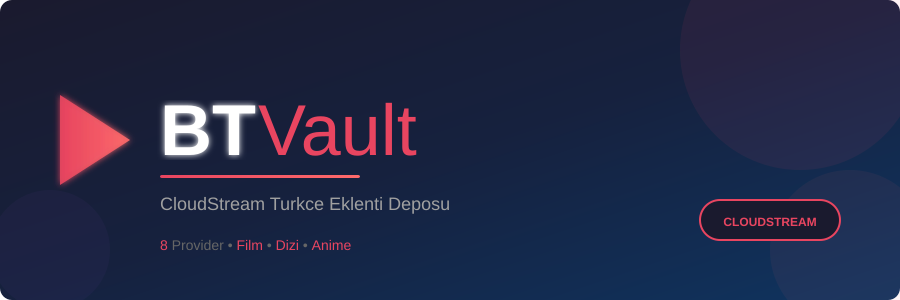

<p align="center">
  
</p>

<h1 align="center">BTVault</h1>

<p align="center">
  <strong>CloudStream Turkce Eklenti Deposu</strong><br>
  Film, dizi, anime ve belgesel platformlari icin tek depo.
</p>

<p align="center">
  <a href="cloudstreamrepo://raw.githubusercontent.com/baristomruk-max/BTVault/main/repo.json">
    
  </a>
  <a href="https://github.com/recloudstream/cloudstream/releases/tag/pre-release">
    
  </a>
  <a href="https://github.com/baristomruk-max/BTVault">
    
  </a>
</p>

---

## Tek Tikla Kurulum

> **Telefonunuzdan asagidaki butona tiklayin, CloudStream otomatik olarak acilacak ve depoyu ekleyecektir.**

<p align="center">
  <a href="cloudstreamrepo://raw.githubusercontent.com/baristomruk-max/BTVault/main/repo.json">
    
  </a>
  <sub>*(CloudStream uygulamasını açar ve repoyu otomatik ekler)*</sub>
</p>

### Manuel Kurulum

1. [CloudStream Pre-Release](https://github.com/recloudstream/cloudstream/releases/tag/pre-release) APK'sini indirip kurun
2. Uygulamada **Ayarlar > Eklentiler > Depo Ekle** bolumune gidin
3. **"URL" fieldsine tam olarak asagidaki linki kopyalayip yapistirin:**

```
https://raw.githubusercontent.com/baristomruk-max/BTVault/main/repo.json
```

> **ÖNEMLİ:** Sadece `BTVault` veya `baristomruk-max` yazmayin! Tam URL'yi kopyalayip yapistirmelisiniz. Aksi takdirde "geçersiz veri" hatası alacaksınız.
>
> **Kısa kod neden çalışmaz?** CloudStream'in kısa kod özelliği bir depo özelliği değildir: tek kelime yazdığınızda uygulama `https://cutt.ly/<kod>` (veya `!<kod>` ile `https://py.md/<kod>`) adresine istek atıp yönlendirme (`Location`) başlığını arar. `cutt.ly/btvault` ve `cutt.ly/baristomruk-max` **404** dönüyor, yani o kısa linkler hiç oluşturulmamış. Kısa kod kullanılabilmesi için `btvault` adına bir cutt.ly kısa linki (ücretsiz hesapla) oluşturulmalı; o olmadan **yalnızca tam URL** çalışır. Alternatif olarak yukarıdaki rozetten tıklayıp `cloudstreamrepo://...` bağlantısını da kullanabilirsiniz.

4. "Depoyu Adı" fieldsine `BTVault` yazabilirsiniz veya bunu boş bırakabilirsiniz.
5. "Tamam" veya "Ekle"'a tiklayin.

---

## Icerik

> **43 eklenti - hepsi aktif.**
>
> - ✅ Aktif: site acik, eklenti bu adreste calisiyor

<table>
  <tr>
    <th>Platform</th>
    <th>Tur</th>
    <th>Durum</th>
  </tr>
  <tr><td>🎬 <strong>4KFilmIzlesene</strong></td><td>Film</td><td>✅ Aktif (4kfilmizlesene.xyz, yeni: nikstream)</td></tr>
  <tr><td>🎭 <strong>AnimeciX</strong></td><td>Anime</td><td>✅ Aktif</td></tr>
  <tr><td>🌸 <strong>AsyaWatch</strong></td><td>Asya Dizi & Film</td><td>✅ Aktif (asyawatch.com, yeni: nikstream)</td></tr>
  <tr><td>🌍 <strong>BelgeselX</strong></td><td>Belgesel</td><td>✅ Aktif</td></tr>
  <tr><td>📡 <strong>CanliTV</strong></td><td>Canli TV</td><td>✅ Aktif (iptv-org TR listesi + 2 yedek ayna)</td></tr>
  <tr><td>📡 <strong>SporTV</strong></td><td>Canli Spor TV</td><td>✅ Aktif (28 dogrulanmis kanal: TRT Spor, beIN Sports, Eurosport, NBA TV)</td></tr>
  <tr><td>🧸 <strong>CizgiMax</strong></td><td>Cizgi Film</td><td>✅ Aktif (yeni tema guncellendi)</td></tr>
  <tr><td>📺 <strong>DiziBox</strong></td><td>Yabanci Dizi</td><td>✅ Aktif (dizibox.live, v17 - tarayici basliklari eklendi)</td></tr>
  <tr><td>📺 <strong>DiziGom</strong></td><td>Yabanci Dizi</td><td>✅ Aktif (dizigom.news, yeni: nikstream)</td></tr>
  <tr><td>📺 <strong>DDizi</strong></td><td>Yabanci Dizi</td><td>✅ Aktif (ddizi.im, yeni: nikstream)</td></tr>
  <tr><td>📺 <strong>Dizilla</strong></td><td>Yabanci Dizi</td><td>✅ Aktif (dizilla.now, v16 - Tailwind/Angular tema entegrasyonu)</td></tr>
  <tr><td>📺 <strong>DiziMag</strong></td><td>Yabanci Dizi</td><td>✅ Aktif (dizimag.dev, yeni: nikstream)</td></tr>
  <tr><td>📺 <strong>DiziMom</strong></td><td>Yerli + Yabanci Dizi</td><td>✅ Aktif (dizidad.com, v14 - hdplayersystem.com duzeltmesi)</td></tr>
  <tr><td>📺 <strong>DiziPal</strong></td><td>Dizi & Film</td><td>✅ Aktif (dizipal3008.com, filmvedizi temasi)</td></tr>
  <tr><td>📺 <strong>Dizipod</strong></td><td>Yabanci Dizi & Film</td><td>✅ Aktif (dizipod.com, yeni - TR altyazili)</td></tr>
  <tr><td>📺 <strong>DiziYou</strong></td><td>Yabanci Dizi</td><td>✅ Aktif (diziyou.one)</td></tr>
  <tr><td>📡 <strong>DMax</strong></td><td>Belgesel & TV</td><td>✅ Aktif (dmax.com.tr, yeni: nikstream)</td></tr>
  <tr><td>🎬 <strong>FilmMakinesi</strong></td><td>Film</td><td>✅ Aktif (filmmakinesi.to, v2 - CloseLoad/Rapid extractor eklentisi eklendi)</td></tr>
  <tr><td>🎬 <strong>FilmIzleIlk</strong></td><td>Film & Dizi</td><td>✅ Aktif (filmizleilk.com, yeni: nikstream)</td></tr>
  <tr><td>🎬 <strong>FilmKovasi</strong></td><td>Film</td><td>✅ Aktif (filmkovasi.com, yeni: nikstream)</td></tr>
  <tr><td>🎬 <strong>FilmModu</strong></td><td>Film</td><td>✅ Aktif (filmmodu.one, v9 - schema.org microdata + lazy afis guncellemesi)</td></tr>
  <tr><td>🎬 <strong>FullHDFilmizlesene</strong></td><td>Film</td><td>✅ Aktif (fullhdfilmizlesene.now, v5 - kategori adresleri düzeltildi)</td></tr>
  <tr><td>🎬 <strong>FullHDFilmIzlede</strong></td><td>Film</td><td>✅ Aktif (fullhdfilmizlede.net, yeni: nikstream)</td></tr>
  <tr><td>🔞 <strong>FullPorner</strong></td><td>Yetiskin (VPN)</td><td>✅ Aktif</td></tr>
  <tr><td>🎬 <strong>HDFilmCehennemi</strong></td><td>Film & Dizi</td><td>✅ Aktif (v19 - tarayici basliklari eklendi)</td></tr>
  <tr><td>🎬 <strong>HDFilmCehennemi2</strong></td><td>Film & Dizi</td><td>✅ Aktif (hdfilmcehennemi2.site, yeni: nikstream)</td></tr>
  <tr><td>?? <strong>HDFilmIzle</strong></td><td>Film & Dizi</td><td>? Aktif (hdfilmizle.to, v2 - Vidrame XOR cozucusu)</td></tr>
  <tr><td>🎬 <strong>HDFilmSitesi</strong></td><td>Film</td><td>✅ Aktif (hdfilmsite.net -> dizifilmizle.to, vidmixi/bepeak destegi)</td></tr>
  <tr><td>🔞 <strong>HQPorner</strong></td><td>Yetiskin (VPN)</td><td>✅ Aktif</td></tr>
  <tr><td>🎬 <strong>IzleAI</strong></td><td>Film</td><td>✅ Aktif</td></tr>
  <tr><td>🎬 <strong>JetFilmizle</strong></td><td>Film</td><td>✅ Aktif (videopark.top worker API entegresi ile v20)</td></tr>
  <tr><td>🎬 <strong>KultFilmler</strong></td><td>Film & Dizi</td><td>✅ Aktif (yeni tema guncellendi)</td></tr>
  <tr><td>🔞 <strong>PornHub</strong></td><td>Yetiskin (VPN)</td><td>✅ Aktif</td></tr>
  <tr><td>📺 <strong>powerDizi</strong></td><td>Canli Dizi TV</td><td>✅ Aktif (M3U playlist, yeni: nikstream)</td></tr>
  <tr><td>📺 <strong>powerSinema</strong></td><td>Canli Film TV</td><td>✅ Aktif (M3U playlist, yeni: nikstream)</td></tr>
  <tr><td>🎬 <strong>RareFilmm</strong></td><td>Film</td><td>✅ Aktif</td></tr>
  <tr><td>?? <strong>SezonlukDizi</strong></td><td>Yabanci Dizi</td><td>? Aktif (sezonlukdizi.cc, v2 - bazi IP'lerde Turnstile kapisi)</td></tr>
  <tr><td>📺 <strong>TLC</strong></td><td>Dizi & Belgesel</td><td>✅ Aktif (tlctv.com.tr, yeni: nikstream)</td></tr>
  <tr><td>📺 <strong>TvDiziler</strong></td><td>Yerli Dizi</td><td>✅ Aktif (tvdiziler.cc, yeni: nikstream)</td></tr>
  <tr><td>📺 <strong>YabanciDizi</strong></td><td>Yabanci Dizi</td><td>✅ Aktif (yabancidizi.so, yeni: nikstream)</td></tr>
  <tr><td>📡 <strong>vavooSpor</strong></td><td>Canli Spor TV</td><td>✅ Aktif (iptv-org spor kategorisi, ulke gruplu - v2)</td></tr>
  <tr><td>🔞 <strong>xHamster</strong></td><td>Yetiskin (VPN)</td><td>✅ Aktif</td></tr>
  <tr><td>▶️ <strong>YouTube</strong></td><td>Video</td><td>✅ Aktif (Invidious, otomatik instance)</td></tr>
</table>

---

## ISP DNS Engeli ve Cozum

Turkiye'deki bazi internet servis saglayicilari (orn. Turk Telekom) asagidaki alan adlarini
DNS seviyesinde `195.175.254.2` (Engelli Web) adresine yonlendiriyor. Bu durumda eklenti
"Baglanti kurulamadi" veya "kaynak bulunamadi" verir; site aslinda canlidir.

**Etkilenen eklentiler:** DiziMag, DiziPal, FullHDFilmIzlede, FullPorner, HQPorner, IzleAI,
PornHub, SpankBang, TvDiziler, UncutMaza, xHamster, YabanciDizi, SporTV (beIN Sports /
Eurosport yayinlari `andro.mangeinde4.lat` uzerinden gelir).

**Cozum:** Telefon/box DNS'ini `8.8.8.8` + `1.1.1.1` yapin veya bir VPN kullanin.
Google DNS ile yapilan testte bu adreslerin hepsi **HTTP 200** dondu; yani eklentiler
calisiyor, engel ISP'nin kendi DNS'inde.

**Google DNS ile de acilmayan (kapali) eklentiler:** FullHDFilm (`fullhdfilm.site`),
RecTV (`b.prectv38.sbs`), SinemaCX (`www.sinema.cx`). Bunlarin alan adi artik yok.

---

## Son Guncellemeler (19.10.2026)

- **Yeni eklenti - SporTV (19.10.2026):** 28 canli spor kanali eklendi; her biri
  `master.m3u8 -> variant.m3u8 -> ilk segment` zinciriyle test edildi (HTTP 200/206).
  - **Turkiye:** TRT Spor, TRT Spor Yildiz, A Spor, beIN Sports 1-5, beIN Sports Haber,
    Eurosport 1-2, HT Spor, FB TV, TJK TV, TJK TV 2.
  - **Dunya:** beIN Sports XTRA, Eurosport, NBA TV, WWE Network, Formula 1, FightBox,
    FightBox HD, Golf Channel, Tennis Channel, Tennis Channel 2, Trace Sport Stars,
    Sport1, Sport2.
  - beIN Sports ve Eurosport yayinlari bazi ISS'lerde DNS engellidir; README'deki DNS
    cozumu ile acilir.
- **vavooSpor duzeltmesi (19.10.2026):** Eski vavoo playlist'indeki `play/<id>` adresleri
  **404** donuyordu. Eklenti `iptv-org` spor kategorisine (481 kanal) tasindi ve kanallar
  `tvg-id` ulke koduna gore gruplandi (US, TR, UK, DE...). Yedek olarak iptv-org TR
  listesinin spor gruplari kullaniliyor.
- **Tek tek tarayici denetimi (19.10.2026):** Tum eklentilerin ana sayfa + detay + oynatici
  zinciri tarayici ve Google DNS uzerinden kontrol edildi.
  - **HDFilmSitesi**: `hdfilmsite.net` artik `dizifilmizle.to`'ya yonlendiriyor; oynatici
    `vidmixi.com/embed/<hash>` + `bePlayer()` AES-CBC sifrelemesine gecmis. Yeni
    `BepeakCrypto` / `BepeakModels` + `vidmixi` cozucusu eklendi.
  - **DiziYou**: `storage.diziyou.one/episodes/<id>/play.m3u8` -> **200 #EXTM3U** (calisiyor).
  - **FilmMakinesi**: `closeload` + `decodePayload` -> **200 #EXTM3U** (calisiyor).
  - **HDFilmCehennemi**: `/video/<id>/` -> `playerr/<token>/` -> kaynak (calisiyor).
  - **DiziBox**: `player/king/king.php` -> `dbx.molystream.org/embed/sheila/<id>` -> **200 #EXTM3U**.
  - **Dizilla**: `#playerLsDizilla iframe` -> `sn.hotlinger.com` -> `m.php` -> **200 #EXTM3U**.
  - **HDFilmIzle (v2)**: Vidrame oynaticisi `EE.dd("...")` yerine satir ici XOR fonksiyonuna
    (`file: (function(d,k){...})([...],"key")`) gecmis; `VidRameExtractor` yeni formati da
    cozecek sekilde guncellendi (mevcut `data-src` iframe'i gercek DOM'da, secici dogru).
  - **DiziMom (v14)**: canli bolumlerde oynatici `hdplayersystem.live`'dan `hdplayersystem.com`'a
    tasinmis; eski host "Player domain is does not match." donuyordu. Extractor hem `.com`
    hem `.live` adresini URL'den turetecek sekilde duzeltildi (`securedLink` -> **200 #EXTM3U**).
  - **SezonlukDizi**: `dataEmbed22.asp` bazi IP'lerde (ozellikle datacenter/VPN) Turnstile
    kapisi donduruyor; ev internetinde dogrudan iframe gelebilir. Yeni `bysejikuar.com`
    oynaticisi PoW (proof-of-work) istiyor; Filemoon alternatifi bu yuzden acilmayabilir.
- **Yeni eklenti - Dizipod (19.10.2026):** `dizipod.com` (yabanci dizi + film, Turkce
  altyazili) eklendi. Ana sayfa, kategori, arama, dizi detayi + tum sezonlar, film detayi
  ve oynatici zinciri dogrulandi: `admin-ajax.php?action=get_episode_player` -> iframe ->
  `player.dizipod.com/embed/<id>.mp4` -> JW Player `sources` -> `gomindex.m3u8` (**200 #EXTM3U**).
- **CanliTV duzeltmesi (19.10.2026):** Eski KekikAkademi playlist'i (`IPTV_YenirMi`) 404
  donuyordu. `iptv-org` TR listesine gecildi; raw/GitHub Pages engellerine karsi 3 ayrik
  adres sirayla deneniyor (iptv-org + iptv-org raw + omerdenizhan/IPTV-M3U).
- **Kaldirilan eklentiler (site kapali):** Tafdi (`tafdi.net` park/blog oldu),
  WFilmIzle (`wfilmizle.my` detay linkleri olu `wfilmizle.vip`'e gidiyor),
  XPrime (`backend.xprime.tv` DNS'te yok).

---

## Son Guncellemeler (06.10.2026)

- **Canli denetim (06.10.2026):** 41 eklentinin tamami Google DNS (8.8.8.8) uzerinden tekrar cekildi. Sonuclar tabloya islendi:
 

- **Yerel Chrome (CDP) ile Dizilla ve DiziMom yeniden yazildi** (her iki site de kendi temasini tamamen degistirmis):


- **8 kanal duzeltildi (DiziBox, Dizilla, DiziYou, DiziMom, FullHDFilmizlesene, FilmModu, JetFilmizle, SezonlukDizi)**:
 
-

## Ozellikler

- 🔍 **Tek Arama** - Tum platformlarda ayni anda arama
- 📥 **Indirme** - Filmleri ve dizileri cevirime indirin
- 📱 **TV Desteği** - Android TV ve tabletlerde calisir
- 🔄 **Otomatik Guncelleme** - Yeni bolumler otomatik eklenir
- 🎬 **Kiralama Modu** - Chromecast ile televizyona aktarin

---

## Yeni Eklenti Ekleme

```bash
# 1. Bu repoyu fork edin
# 2. Yeni klasor olusturun
mkdir YeniPlatform

# 3. Gerekli dosyalari olusturun
# - build.gradle.kts (metadata)
# - src/main/AndroidManifest.xml
# - src/main/kotlin/com/btcozum/btvault/YeniPlatformPlugin.kt
# - src/main/kotlin/com/btcozum/btvault/YeniPlatform.kt

# 4. Push edin, GitHub Actions otomatik derler
git push origin main
```

---

## Gelistirme

```bash
# Yerel derleme
.\gradlew.bat FilmMakinesi:make

# Tek provider derleme
.\gradlew.bat HDFilmCehennemi:make

# Tum provider'lari derleme
.\gradlew.bat make

# plugins.json uret
.\gradlew.bat makePluginsJson
```

### Canli dogrulama scriptleri

`scripts/` altindaki scriptler her provider'in ana adresini Google DNS (8.8.8.8) uzerinden
cozup canli olarak ceker, sonra kullanilan CSS selector'lerin hala sayfada olup olmadigini kontrol eder.
(Yerel router DNS'i bir cok streaming alan adini 195.175.254.2'ye yonlendirdigi icin Google DNS kullanilir.)

```powershell
.\scripts\check-sites.ps1    # her provider'in ana adresi -> HTTP durumu, baslik, HTML
.\scripts\audit.ps1         # ana sayfa + arama ucunu canli cekip sonuc uretir
.\scripts\verify-sel.ps1     # kod icindeki selector'lerin ana sayfada kacisi var

# asama 2 - arama ucunu ve detay sayfayi canli dogrula
.\scripts\verify-search.ps1  # search() token'lari -> scripts/site-checks-search/
.\scripts\verify-load.ps1    # sonuc baglantisi -> detay/sezon sayfasi -> load() token'lari
.\scripts\check-tokens.ps1   # tek bir URL icin load() token raporu: -Url ... -Name ...

# asama 3 - tek tek eklenti zincir dogrulamasi (arama -> load -> loadLinks)
.\scripts\verify-izleai.ps1      # IzleAI      AES secureData + pichive zinciri
.\scripts\verify-belgeselx.ps1   # BelgeselX   diziGetir + /video/data/<map>.php
.\scripts\verify-dizibox.ps1     # DiziBox     player/*.php -> molystream HLS / vidmoly / ok.ru
.\scripts\verify-dizipal.ps1     # DiziPal     filmvedizi -> /dl (Origin) -> HLS
.\scripts\verify-sezonlukdizi.ps1 # SezonlukDizi  arama JSON + dataAlternatif22/dataEmbed22
```

`verify-load.ps1` film + dizi (sezon) sayfasini birlestirerek bakar; bazi seciciler
yalnizca dizi sayfasinda (`seasons`, `epsection`) ya da yalnizca film sayfasinda bulunur.
Kod icinde birebir yedek seciciler (`ccast`/`cm`, `mv-det-p`) `$allow` listesi ile isaretlidir.

---

## Tesekkurler

| | Proje |
|---|---|
| 🙏 | [KekikAkademi](https://github.com/keyiflerolsun/Kekik-cloudstream) - Kaynak provider kodlari |
| 🙏 | [CloudStream](https://github.com/recloudstream/cloudstream) - Uygulama |
| 🙏 | [recloudstream](https://github.com/recloudstream) - Topluluk |

---

<p align="center">
  <sub>BTVault &copy; 2026 | <a href="https://github.com/baristomruk-max">baristomruk-max</a> | GPL-3.0</sub>
</p>
