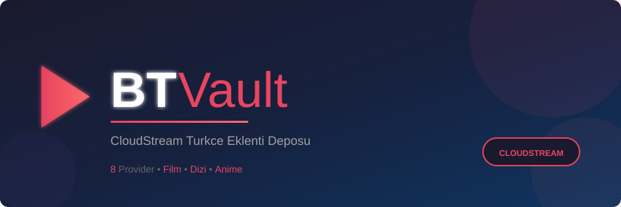

<p align="center">
  
</p>

<h1 align="center">BTVault</h1>

<p align="center">
  <strong>CloudStream Turkce Eklenti Deposu</strong><br>
  Film, dizi, anime ve belgesel platformlari icin tek depo.
</p>

<p align="center">
  <a href="cloudstreamrepo://raw.githubusercontent.com/baristomruk-max/BTVault/main/repo.json">
    
  </a>
  <a href="https://github.com/recloudstream/cloudstream/releases/tag/pre-release">
    
  </a>
  <a href="https://github.com/baristomruk-max/BTVault">
    
  </a>
</p>

---

## Tek Tikla Kurulum

> **Telefonunuzdan asagidaki butona tiklayin, CloudStream otomatik olarak acilacak ve depoyu ekleyecektir.**

<p align="center">
  <a href="cloudstreamrepo://raw.githubusercontent.com/baristomruk-max/BTVault/main/repo.json">
    
  </a>
  <sub>*(CloudStream uygulamasını açar ve repoyu otomatik ekler)*</sub>
</p>

### Manuel Kurulum

1. [CloudStream Pre-Release](https://github.com/recloudstream/cloudstream/releases/tag/pre-release) APK'sini indirip kurun
2. Uygulamada **Ayarlar > Eklentiler > Depo Ekle** bolumune gidin
3. **"URL" fieldsine tam olarak asagidaki linki kopyalayip yapistirin:**

```
https://raw.githubusercontent.com/baristomruk-max/BTVault/main/repo.json
```

> **ÖNEMLİ:** Sadece `BTVault` veya `baristomruk-max` yazmayin! Tam URL'yi kopyalayip yapistirmelisiniz. Aksi takdirde "geçersiz veri" hatası alacaksınız.
>
> **Kısa kod neden çalışmaz?** CloudStream'in kısa kod özelliği bir depo özelliği değildir: tek kelime yazdığınızda uygulama `https://cutt.ly/<kod>` (veya `!<kod>` ile `https://py.md/<kod>`) adresine istek atıp yönlendirme (`Location`) başlığını arar. `cutt.ly/btvault` ve `cutt.ly/baristomruk-max` **404** dönüyor, yani o kısa linkler hiç oluşturulmamış. Kısa kod kullanılabilmesi için `btvault` adına bir cutt.ly kısa linki (ücretsiz hesapla) oluşturulmalı; o olmadan **yalnızca tam URL** çalışır. Alternatif olarak yukarıdaki rozetten tıklayıp `cloudstreamrepo://...` bağlantısını da kullanabilirsiniz.

4. "Depoyu Adı" fieldsine `BTVault` yazabilirsiniz veya bunu boş bırakabilirsiniz.
5. "Tamam" veya "Ekle"'a tiklayin.

---

## Icerik

> **64 eklenti - 41 aktif, 23 kapali (06.11.2026).**
>
> - ✅ Aktif: site acik, eklenti bu adreste calisiyor
> - ⛔ Kapali: site olu / park / yeni tema (yeniden yazim bekliyor)
>
> Guncel teshis ve yol haritasi: [RAPOR-2026-11-06.md](RAPOR-2026-11-06.md)

**✅ Aktif (41)**

<table>
  <tr>
    <th>Platform</th>
    <th>Tur</th>
    <th>Durum</th>
  </tr>
  <tr><td>🎭 <strong>AnimeciX</strong></td><td>Anime</td><td>✅ Aktif</td></tr>
  <tr><td>🌸 <strong>AsyaWatch</strong></td><td>Asya Dizi & Film</td><td>✅ Aktif (asyawatch.com)</td></tr>
  <tr><td>🌍 <strong>BelgeselX</strong></td><td>Belgesel</td><td>✅ Aktif</td></tr>
  <tr><td>📡 <strong>CanliTV</strong></td><td>Canli TV</td><td>✅ Aktif (iptv-org TR listesi + 2 yedek ayna)</td></tr>
  <tr><td>🧸 <strong>CizgiMax</strong></td><td>Cizgi Film</td><td>✅ Aktif (yeni tema guncellendi)</td></tr>
  <tr><td>📺 <strong>DDizi</strong></td><td>Yabanci Dizi</td><td>✅ Aktif (ddizi.tel - yeni tema, v2)</td></tr>
  <tr><td>📺 <strong>DiziBox</strong></td><td>Yabanci Dizi</td><td>✅ Aktif (dizibox.live; VPN/sunucu IP'lerini engelliyor)</td></tr>
  <tr><td>📺 <strong>DiziGom</strong></td><td>Yabanci Dizi</td><td>✅ Aktif (dizigom.news)</td></tr>
  <tr><td>📺 <strong>DiziMag</strong></td><td>Yabanci Dizi</td><td>✅ Aktif (dizimag.onl, v2 - alan adi guncellendi)</td></tr>
  <tr><td>📺 <strong>DiziPal</strong></td><td>Dizi & Film</td><td>✅ Aktif (dizipal3009.com, filmvedizi temasi)</td></tr>
  <tr><td>📺 <strong>Dizipod</strong></td><td>Yabanci Dizi & Film</td><td>✅ Aktif (dizipod.com - TR altyazili)</td></tr>
  <tr><td>📺 <strong>DiziYou</strong></td><td>Yabanci Dizi</td><td>✅ Aktif (diziyou.one)</td></tr>
  <tr><td>📡 <strong>DMax</strong></td><td>Belgesel & TV</td><td>✅ Aktif (dmax.com.tr)</td></tr>
  <tr><td>🎬 <strong>FilmIzleIlk</strong></td><td>Film & Dizi</td><td>✅ Aktif (filmizleilk.com)</td></tr>
  <tr><td>🎬 <strong>FilmMakinesi</strong></td><td>Film</td><td>✅ Aktif (filmmakinesi.to - CloseLoad/Rapid extractor)</td></tr>
  <tr><td>🎬 <strong>FilmModu</strong></td><td>Film</td><td>✅ Aktif (filmmodu.one - schema.org microdata + lazy afis)</td></tr>
  <tr><td>🎬 <strong>FullHDFilmIzlede</strong></td><td>Film</td><td>✅ Aktif (fullhdfilmizlede.net)</td></tr>
  <tr><td>🎬 <strong>FullHDFilmizlesene</strong></td><td>Film</td><td>✅ Aktif (fullhdfilmizlesene.now - kategori adresleri duzeltildi)</td></tr>
  <tr><td>🔞 <strong>FullPorner</strong></td><td>Yetiskin (VPN)</td><td>✅ Aktif</td></tr>
  <tr><td>🎬 <strong>HDFilmCehennemi</strong></td><td>Film & Dizi</td><td>✅ Aktif (tarayici basliklari eklendi)</td></tr>
  <tr><td>🎬 <strong>HDFilmCehennemi2</strong></td><td>Film & Dizi</td><td>✅ Aktif (hdfilmcehennemi2.biz, v3 - yeni Laravel/Livewire temasi, vidload/vidmoly oynatici)</td></tr>
  <tr><td>🎬 <strong>HDFilmIzle</strong></td><td>Film & Dizi</td><td>✅ Aktif (hdfilmizle.live - Vidrame XOR cozucusu)</td></tr>
  <tr><td>🔞 <strong>HQPorner</strong></td><td>Yetiskin (VPN)</td><td>✅ Aktif</td></tr>
  <tr><td>🎬 <strong>IzleAI</strong></td><td>Film</td><td>✅ Aktif (selcukflix.app, v6 - alan adi guncellendi)</td></tr>
  <tr><td>🎬 <strong>JetFilmizle</strong></td><td>Film</td><td>✅ Aktif (jetfilmizle.app, v21 - alan adi guncellendi)</td></tr>
  <tr><td>🎬 <strong>KultFilmler</strong></td><td>Film & Dizi</td><td>✅ Aktif (yeni tema guncellendi)</td></tr>
  <tr><td>🔞 <strong>PornHub</strong></td><td>Yetiskin (VPN)</td><td>✅ Aktif</td></tr>
  <tr><td>📺 <strong>powerDizi</strong></td><td>Canli Dizi TV</td><td>✅ Aktif (M3U playlist)</td></tr>
  <tr><td>📺 <strong>powerSinema</strong></td><td>Canli Film TV</td><td>✅ Aktif (M3U playlist)</td></tr>
  <tr><td>🎬 <strong>RareFilmm</strong></td><td>Film</td><td>✅ Aktif</td></tr>
  <tr><td>📺 <strong>SezonlukDizi</strong></td><td>Yabanci Dizi</td><td>⚠️ Aktif (sezonlukdizi.cc - bazi IP'lerde Turnstile kapisi)</td></tr>
  <tr><td>🔞 <strong>SpankBang</strong></td><td>Yetiskin (VPN)</td><td>⚠️ Aktif (Cloudflare - cihazda test edilmeli)</td></tr>
  <tr><td>📡 <strong>SporTV</strong></td><td>Canli Spor TV</td><td>✅ Aktif (28 dogrulanmis kanal)</td></tr>
  <tr><td>📺 <strong>TLC</strong></td><td>Dizi & Belgesel</td><td>✅ Aktif (tlctv.com.tr)</td></tr>
  <tr><td>🔞 <strong>UncutMaza</strong></td><td>Yetiskin (VPN)</td><td>⚠️ Aktif (Cloudflare - cihazda test edilmeli)</td></tr>
  <tr><td>📡 <strong>vavooSpor</strong></td><td>Canli Spor TV</td><td>✅ Aktif (iptv-org spor kategorisi, ulke gruplu)</td></tr>
  <tr><td>🎬 <strong>WebteIzle</strong></td><td>Film</td><td>⚠️ Aktif (Cloudflare - cihazda test edilmeli)</td></tr>
  <tr><td>🔞 <strong>xHamster</strong></td><td>Yetiskin (VPN)</td><td>✅ Aktif</td></tr>
  <tr><td>🎬 <strong>XPrime</strong></td><td>Film & Dizi (TMDB)</td><td>✅ Aktif (TMDB API)</td></tr>
  <tr><td>📺 <strong>YabanciDizi</strong></td><td>Yabanci Dizi</td><td>✅ Aktif (yabancidizi.news, v2 - alan adi + API adresleri guncellendi)</td></tr>
  <tr><td>▶️ <strong>YouTube</strong></td><td>Video</td><td>✅ Aktif (yt.chocolatemoo53.com + yedek Invidious, v5)</td></tr>
</table>

**⛔ Kapali (23)**

<table>
  <tr>
    <th>Platform</th>
    <th>Tur</th>
    <th>Durum</th>
  </tr>
  <tr><td>📺 <strong>Dizilla</strong></td><td>Yabanci Dizi</td><td>⛔ Kapali (dizilla.la yeni Next.js tema - oynatici yeniden yazilmali)</td></tr>
  <tr><td>🎬 <strong>4KFilmIzlesene</strong></td><td>Film</td><td>⛔ Kapali (4kfilmizlesene.xyz Wayback arsivine dondu, detay 404)</td></tr>
  <tr><td>📺 <strong>DiziKorea</strong></td><td>Kore Dizisi</td><td>⛔ Kapali (dizikorea.info - origin 526 SSL)</td></tr>
  <tr><td>📺 <strong>DiziMom</strong></td><td>Yerli + Yabanci Dizi</td><td>⛔ Kapali (dizidad.com ve tum alan adlari park/redirect)</td></tr>
  <tr><td>🎬 <strong>FilmKovasi</strong></td><td>Film</td><td>⛔ Kapali (Next.js yeni tema - yeniden yazim bekliyor)</td></tr>
  <tr><td>🎬 <strong>FullHDFilm</strong></td><td>Film & Dizi</td><td>⛔ Kapali (site kapali)</td></tr>
  <tr><td>📡 <strong>GolgeTV</strong></td><td>Canli TV</td><td>⛔ Kapali (kaynak kapali)</td></tr>
  <tr><td>🎬 <strong>HDFilmSitesi</strong></td><td>Film</td><td>⛔ Kapali (dizifilmizle.to, Nuxt - yeniden yazim bekliyor)</td></tr>
  <tr><td>📺 <strong>InatBox</strong></td><td>Film & Dizi & TV</td><td>⛔ Kapali (dizibox.rest + boxbc.sbs backend erisilemez)</td></tr>
  <tr><td>📺 <strong>KoreanTurk</strong></td><td>Kore Dizisi</td><td>⛔ Kapali (koreanturk.com - origin 522)</td></tr>
  <tr><td>🎬 <strong>NetflixMirror</strong></td><td>Film & Dizi</td><td>⛔ Kapali (iosmirror.cc kaynagi kapali)</td></tr>
  <tr><td>🔞 <strong>OxAx</strong></td><td>Yetiskin & Canli (VPN)</td><td>⛔ Kapali (kaynak kapali)</td></tr>
  <tr><td>🎬 <strong>RecTV</strong></td><td>Film & Dizi & TV</td><td>⛔ Kapali (prectv38.sbs kaynagi kapali)</td></tr>
  <tr><td>🎬 <strong>SetFilmIzle</strong></td><td>Film & Dizi</td><td>⛔ Kapali (explay.store kaynagi kapali)</td></tr>
  <tr><td>🎬 <strong>SinemaCX</strong></td><td>Film</td><td>⛔ Kapali (kaynak kapali)</td></tr>
  <tr><td>🎬 <strong>SineWix</strong></td><td>Film & Dizi & Anime</td><td>⛔ Kapali (kaynak kapali)</td></tr>
  <tr><td>🎬 <strong>SuperFilmGeldi</strong></td><td>Film</td><td>⛔ Kapali (mixplayhd.com kaynagi kapali)</td></tr>
  <tr><td>🎬 <strong>Tafdi</strong></td><td>Film</td><td>⛔ Kapali (tafdi.net WordPress bloga donustu)</td></tr>
  <tr><td>🎭 <strong>TurkAnime</strong></td><td>Anime</td><td>⛔ Kapali (kaynak kapali)</td></tr>
  <tr><td>📺 <strong>TvDiziler</strong></td><td>Yerli Dizi</td><td>⛔ Kapali (tvdiziler.tv yeni tema - yeniden yazim bekliyor)</td></tr>
  <tr><td>🎬 <strong>UgurFilm</strong></td><td>Film</td><td>⛔ Kapali (kaynak kapali)</td></tr>
  <tr><td>🎬 <strong>Watch2Movies</strong></td><td>Film</td><td>⛔ Kapali (yapim asamasinda)</td></tr>
  <tr><td>🎬 <strong>WFilmIzle</strong></td><td>Film</td><td>⛔ Kapali (detay linkleri NXDOMAIN wfilmizle.vip'e gidiyor)</td></tr>
</table>

---

## Son Guncellemeler (01.11.2026)

- **Tum depolar tarandi (64 eklenti):** Her provider'in `mainUrl`'i Google DNS (8.8.8.8)
  ile cozuldu, `curl --resolve` ile ana sayfa/arama/detay cekildi ve kodun kullandigi
  seciciler HTML ile karsilastirildi. Ozet: 42 aktif, 22 kapali.
  Ayrinti: [RAPOR-2026-11-06.md](RAPOR-2026-11-06.md).
- **Alan adi guncellenenler (tema ayni):** DiziMag `dizimag.onl`, YabanciDizi
  `yabancidizi.news` (API adresleri de `$mainUrl`'e tasindi), JetFilmizle
  `jetfilmizle.app`, IzleAI `selcukflix.app`.
- **YouTube (v5):** `invidious.f5.si` 530 verdigi icin `mainUrl`
  `yt.chocolatemoo53.com` yapildi; yedekler `invidious.materialio.us` ve `yewtu.be`.
- **Kapatilanlar (status = 0):** TvDiziler, HDFilmSitesi, FilmKovasi
  (site tamamen yeni temaya gecti, yeniden yazim bekliyor); DiziMom, 4KFilmIzlesene,
  Tafdi, WFilmIzle (site olu/park/NXDOMAIN).
- **DiziKorea / KoreanTurk:** Origin tarafinda 526 (SSL) ve 522 (timeout) var;
  site duzelince `status` tekrar 1 yapilacak.
- **XPrime:** `backend.xprime.tv` olmadan TMDB API ile calisiyor (dogrulandi).

---

## ISP DNS Engeli ve Cozum

Turkiye'deki bazi internet servis saglayicilari (orn. Turk Telekom) asagidaki alan adlarini
DNS seviyesinde `195.175.254.2` (Engelli Web) adresine yonlendiriyor. Bu durumda eklenti
"Baglanti kurulamadi" veya "kaynak bulunamadi" verir; site aslinda canlidir.

**Etkilenen eklentiler:** DiziMag, DiziPal, FullHDFilmIzlede, FullPorner, HQPorner, IzleAI,
PornHub, SpankBang, TvDiziler, UncutMaza, xHamster, YabanciDizi, SporTV (beIN Sports /
Eurosport yayinlari `andro.mangeinde4.lat` uzerinden gelir).

**Cozum:** Telefon/box DNS'ini `8.8.8.8` + `1.1.1.1` yapin veya bir VPN kullanin.
Google DNS ile yapilan testte bu adreslerin hepsi **HTTP 200** dondu; yani eklentiler
calisiyor, engel ISP'nin kendi DNS'inde.

**Google DNS ile de acilmayan (kapali) eklentiler:** Ornekler: FullHDFilm
(`fullhdfilm.site`), RecTV (`b.prectv38.sbs`), SinemaCX (`www.sinema.cx`). Bu alan adlari
artik yok; kapali 17 eklentinin tam listesi `RAPOR-2026-11-01.md` icinde.

---


## Tesekkurler

| | Proje |
|---|---|
| 🙏 | [KekikAkademi](https://github.com/keyiflerolsun/Kekik-cloudstream) - Kaynak provider kodlari |
| 🙏 | [CloudStream](https://github.com/recloudstream/cloudstream) - Uygulama |
| 🙏 | [recloudstream](https://github.com/recloudstream) - Topluluk |

---

<p align="center">
  <sub>BTVault &copy; 2026 | <a href="https://github.com/baristomruk-max">baristomruk-max</a> | GPL-3.0</sub>
</p>
